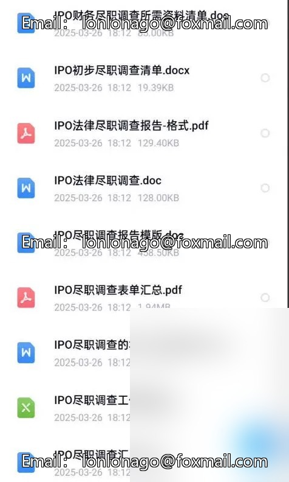
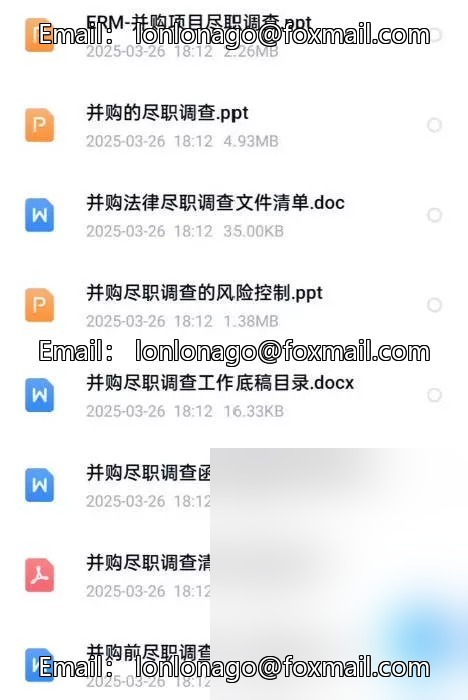
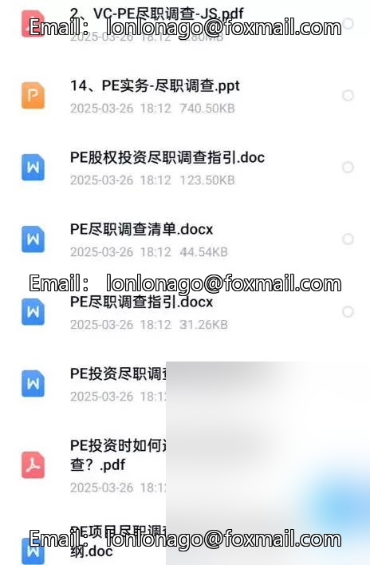

# 460-copy due diligence IPO M&A investment legal report financial table tool list guide model

## Body

460-instrument due diligence IPO M&A investment legal report and financial table tool list guide template data
Including:
1. IPO due diligence
2. VC-PE due diligence
3. M&A due diligence
4. Financial due diligence
5. Legal lawyer due diligence
6. Due diligence report
7. Due diligence table and tool
8. Due diligence methods
9. Due diligence content
10. Due diligence list
11. Other due diligence materials
12. Enterprise due diligence
13. Listed company due diligence
14. Project due diligence
15. New Third Board due diligence
16. Bond-related due diligence

web-based shipment, can be directly photographed and shipped.

This provides a list of templates for due diligence, IPO, M&A and investment legal reporting and financial spreadsheet tools, covering areas including IPO, VC-PE, M&A, finance, legal due diligence and related reports.

<!-- AI_ENRICHED -->

## Images

## Payment

Here is a pay link on Stripe ( https://buy.stripe.com/3cs8yP7sY87d0vu9AB ). Please contact me lonlonago@foxmail.com after funding $89, and I will send you a complete data files , thank you!

